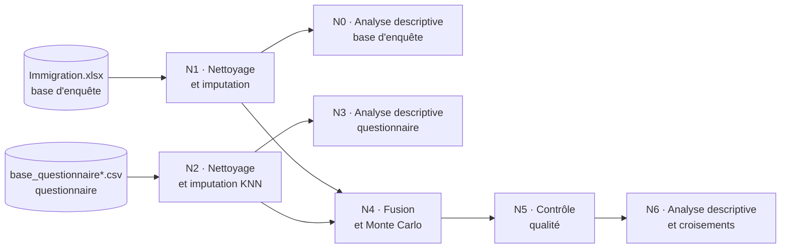

# Données d'enquête sur les intentions migratoires — nettoyage, imputation et data visualisation

Pipeline Python de bout en bout : nettoyage de deux sources hétérogènes, stratégie d'imputation hiérarchisée, fusion de schémas et analyse descriptive visuelle.


> [!WARNING]
> **Les données de ce dépôt sont simulées.**
> Les données d'origine du projet sont soumises à une stricte obligation de confidentialité : elles ne sont pas publiées, et aucun résultat de l'étude n'apparaît dans ce dépôt.
>
> Toutes les données utilisées ici sont **générées artificiellement** par [`generate_dummy_data.py`](generate_dummy_data.py). Ce script reproduit uniquement la *structure* des fichiers d'origine (noms de colonnes, types, encodages, motifs de valeurs manquantes). Les valeurs sont tirées au hasard, indépendamment les unes des autres.
>
> Les chiffres et graphiques affichés dans les notebooks **ne décrivent aucune population réelle** et ne doivent pas être interprétés. Les commentaires ont été réécrits pour décrire le code et la méthode.

---

## Contexte

Stage de **Licence 3 MIASHS** réalisé en binôme à l'**Université Toulouse - Jean Jaurès** (avril – juin 2026). L'objectif : construire une base analytique unique à partir de deux sources, puis analyser les facteurs associés à l'intention de migrer, avec une variable cible binaire.

- une **base d'enquête** fournie dans le cadre du projet (variables déjà codées) ;
- un **questionnaire** conçu, diffusé et exporté par nos soins, qui ajoute des variables économiques et personnelles.

## Compétences mises en œuvre

| Domaine | Ce que montre le dépôt |
|---|---|
| **Qualité des données** | Diagnostic des valeurs manquantes, typage, normalisation des noms de colonnes, suppression des questionnaires abandonnés |
| **Imputation** | Choix de la méthode selon le taux de manquants : mode/médiane (< 2 %), `KNNImputer` (10-20 %), `IterativeImputer` + `RandomForestRegressor` (≥ 50 %), Monte Carlo après fusion |
| **Évaluation** | Validation de l'imputation par masquage de 20 % des valeurs connues, lecture de l'accuracy face à la baseline, diagnostic des faux positifs et faux négatifs |
| **Intégration de sources** | Comparaison ensembliste des schémas, harmonisation des encodages, gestion des codes hors nomenclature, concaténation |
| **Data visualisation** | Graphique adapté à chaque type de variable, diagrammes divergents, tableaux de contingence normalisés, boîtes à moustaches, barres groupées |
| **Rigueur et reproductibilité** | Graines fixées, chemins relatifs, traçabilité des variables imputées, données synthétiques fidèles au schéma, limites documentées |

## Pipeline



| Notebook | Rôle |
|---|---|
| [`N1_nettoyage_immigration`](notebooks/N1_nettoyage_immigration.ipynb) | Nettoyage de la base d'enquête et imputation hiérarchisée (mode, médiane, KNN, forêts aléatoires), évaluation par masquage |
| [`N0_descriptive_base_fournie`](notebooks/N0_descriptive_base_fournie.ipynb) | Analyse descriptive univariée de la base d'enquête |
| [`N2_nettoyage_questionnaire`](notebooks/N2_nettoyage_questionnaire.ipynb) | Nettoyage de l'export du questionnaire, harmonisation avec le schéma de la base d'enquête, imputation KNN |
| [`N3_descriptive_questionnaire`](notebooks/N3_descriptive_questionnaire.ipynb) | Analyse descriptive du questionnaire, mêmes conventions graphiques que N0 |
| [`N4_fusion_montecarlo`](notebooks/N4_fusion_montecarlo.ipynb) | Diagnostic des schémas, fusion des deux sources, imputation Monte Carlo |
| [`N5_nettoyage_base_fusionnee`](notebooks/N5_nettoyage_base_fusionnee.ipynb) | Contrôle qualité et typage de la base fusionnée |
| [`N6_descriptive_afrique`](notebooks/N6_descriptive_afrique.ipynb) | Analyse d'un sous-échantillon géographique : distributions puis croisements avec la variable cible |

Les choix techniques de chaque étape sont détaillés dans **[METHODOLOGY.md](METHODOLOGY.md)**.

## Structure du dépôt

```
.
├── README.md
├── METHODOLOGY.md             # choix de nettoyage, d'imputation et de visualisation
├── generate_dummy_data.py     # génération des données synthétiques
├── requirements.txt
├── data/                      # vide dans le dépôt, rempli par le générateur puis par les notebooks
│   ├── 1_Donnees_brutes/
│   ├── 2_Donnees_nettoyees/
│   └── 3_Donnees_fusionnees/
└── notebooks/
    ├── N0_descriptive_base_fournie.ipynb
    ├── N1_nettoyage_immigration.ipynb
    ├── N2_nettoyage_questionnaire.ipynb
    ├── N3_descriptive_questionnaire.ipynb
    ├── N4_fusion_montecarlo.ipynb
    ├── N5_nettoyage_base_fusionnee.ipynb
    └── N6_descriptive_afrique.ipynb
```

## Stack technique

| Outil | Usage |
|---|---|
| **pandas** | Chargement Excel/CSV, nettoyage, `groupby`, `crosstab`, `concat` |
| **NumPy** | Pondérations, tirages Monte Carlo, jitter |
| **scikit-learn** | `KNNImputer`, `IterativeImputer`, `RandomForestRegressor`, `accuracy_score` |
| **Matplotlib** | Toutes les figures (barres, secteurs, histogrammes, diagrammes divergents, boîtes à moustaches) |
| **Faker** | Champs texte libre et dates des données synthétiques |
| **openpyxl** | Lecture et écriture des fichiers `.xlsx` |
| **Jupyter** | Notebooks, exécution par `nbconvert` |

## Lancer le projet

Prérequis : Python 3.12.

```bash
python -m venv .venv
source .venv/bin/activate          # Windows : .venv\Scripts\activate
pip install -r requirements.txt
```

**1. Générer les données synthétiques** (options : `--n-survey`, `--n-questionnaire`, `--seed`)

```bash
python generate_dummy_data.py
```

**2. Exécuter les notebooks dans l'ordre du pipeline** : N1 → N0 → N2 → N3 → N4 → N5 → N6. Chaque notebook lit le fichier produit par l'étape précédente.

```bash
cd notebooks
for nb in N1 N0 N2 N3 N4 N5 N6; do jupyter nbconvert --to notebook --execute --inplace ${nb}_*.ipynb; done
```

Pour une utilisation interactive, installer JupyterLab (`pip install jupyterlab`) et lancer les notebooks depuis le dossier `notebooks/` : les chemins sont relatifs à ce dossier.

## À propos des données synthétiques

`generate_dummy_data.py` produit les trois fichiers d'entrée du pipeline :

| Fichier | Contenu |
|---|---|
| `Immigration.xlsx` | Base d'enquête : 21 colonnes codées |
| `base_questionnaire.csv` | Export « codes » du questionnaire : 49 colonnes (métadonnées, 42 questions, 2 champs texte libre) |
| `base_questionnaire_brute.csv` | Export « réponses complètes » : identique, mais le pays est un libellé texte |

Ce qui est **reproduit** : noms de colonnes exacts (fautes de frappe et espaces parasites compris, pour que le code s'exécute sans modification), types, domaines de valeurs de chaque variable, questions filtrées, abandons page par page, champs texte libre, et taux de manquants dans les mêmes *tranches* que l'original pour que chaque branche de la stratégie d'imputation s'exécute.

Ce qui **n'est pas reproduit** : les distributions et les relations entre variables. Les proportions de chaque modalité sont tirées au hasard (loi de Dirichlet) et chaque variable est générée indépendamment des autres. Les croisements de N6 n'ont donc aucune signification : ils montrent seulement que le code fonctionne.

Le script vérifie la structure produite avant d'écrire les fichiers (nombre de colonnes, modalités, taux de manquants).

## Auteurs

- **Olti MJEKU**
- **Pensée BUISSON**
